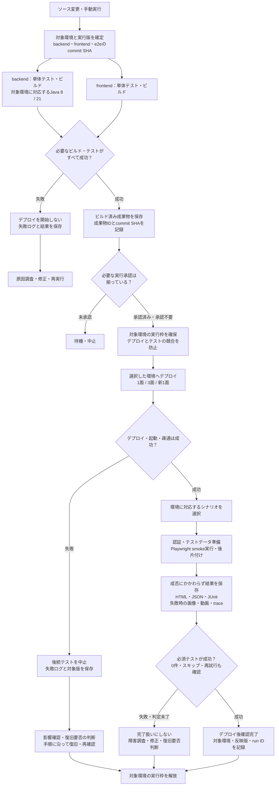

# Playwright × GitHub Actionsによる開発プロセス整備

## 1. 目標

**10万件の障害に耐えられる開発プロセスを具体化する。**

- Playwrightで障害の事前検知とテスト準備を効率化する。
- GitHub Actionsで自動ビルド・自動デプロイを実現し、障害修正の反映を高速化する。
- 構成・ソース・ツール・マニュアルを整備し、他メンバーへ展開できる、属人化しない運用にする。

※「10万件」は原文の目標値。対象となる障害の定義や達成度の測定方法は要確認。

## 2. 対象範囲

| 対象                       | 実現すること                                   |
| -------------------------- | ---------------------------------------------- |
| Playwright：STの簡易化     | 画面要素と画面遷移の検証、シナリオ作成の効率化 |
| Playwright：UT準備の簡易化 | 画面操作によるテストデータ準備                 |
| GitHub Actions             | 自動ビルド・自動デプロイ                       |

## 3. 成果物

1. **開発プロセスの具体案**：10万件の障害の事前検知・修正に対応する流れ。
2. **Playwrightの構成とソース**：既存構成への組み込み方を含む。
3. **GitHub Actionsの構成とソース**：ビルド・デプロイの自動化。
4. **POM・シナリオ作成ツール**：UI仕様・シナリオ仕様からコードを作成するツール。
5. **展開用マニュアル**：ベンダ・事業部・他メンバーが利用できる手順書。

POM：Page Object Model。

## 4. プロジェクト概要

### 企画と日程

| 企画                   | 日程          |
| ---------------------- | ------------- |
| ノングレードチャレンジ | 2027年3月25日 |
| 紙・タッチ講座         | 2027年7月25日 |

※2027年7月25日は紙・タッチ講座のリリース日。2027年3月25日の節目の内容は要確認。

### 環境

| 区分     | 面数  | Javaの構成 | 備考                          |
| -------- | ----- | ---------- | ----------------------------- |
| 新規環境 | 3面   | Java 21    | —                            |
| 既存環境 | 1面   | Java 8     | 2027年4月ごろJava 21へ移行    |
| 新規環境 | 新1面 | Java 21    | 2027年7月25日リリース後に削除 |

### GitHub上のソース区分

- `backend`
- `frontend`
- `doc`

※リポジトリ単位か、同一リポジトリ内のディレクトリ単位かは要確認。

## 5. 全体スケジュール

| 時期                    | 工程・活動                                                       | 備考                                                            |
| ----------------------- | ---------------------------------------------------------------- | --------------------------------------------------------------- |
| 10〜11月（年未記載）    | 各ベンダによる製造・単体テスト、Playwright・GitHub Actionsの整備 | 準備対象は既存1面・Java 8                                       |
| 12月（年未記載）        | 結合テスト、3面適用、マニュアル展開                              | Playwright・GitHub Actionsを3面へ適用。上旬・下旬の区別は要確認 |
| 2027年1月               | システムテスト、STシナリオ効率化の実施                           | Playwrightの目的①                                              |
| 2027年2月               | ユーザテスト、UTデータ準備効率化の実施                           | Playwrightの目的②。UTの意味は要確認                            |
| 2027年3月25日           | ノングレードチャレンジの企画日程                                 | 節目の内容は未記載                                              |
| 2027年4月               | 新1面適用、既存1面のJava 21移行・開発フロー組み込み              | Playwright・GitHub Actionsを新1面へ適用。既存1面の移行は4月ごろ |
| 2027年7月25日           | 紙・タッチ講座リリース                                           | リリース後に新1面を削除                                         |
| 2027年7月25日リリース後 | 新1面の削除・運用整理                                            | 削除条件と継続する回帰の実行先を確認                            |

## 6. 製造・単体テスト：10〜11月の準備・完了基準

対象期間：10〜11月（年未記載）。対象環境：既存1面・Java 8。

以下は、元の目標を具体化した**完了基準案**。基準を記載したこと自体は達成を意味しない。各項目は成果物・実行記録・レビュー結果で確認し、担当者と確認者を決めて運用する。

### 6.1 全工程共通の判定ルール

- 工程開始時に、対象環境・画面・シナリオ・実行範囲・対象外とその理由を一覧化する。
- 対象件数に対する作成済み・実行済み・成功・失敗・スキップ・未実施の件数を記録する。0件実行やスキップを合格として扱わない。
- 必須対象は全件を実行し、成功、または未解決事項として明示的に判定する。失敗・未実施が残る場合は、理由・影響・代替確認・解消期限・判定者を記録し、次工程へ進めるかを判断する。
- 再試行で成功したケースも最初の失敗を記録し、不安定なテストを無条件に成功扱いしない。
- 対象・接続先・アプリの版・テストコードのcommit SHA・Actionsのrun IDから結果を追跡できる。
- 実行手順・結果確認・再実行・データ後片付けを、作成者以外のメンバーがマニュアルで再現できる。

「10万件」は目標として維持するが、定義が未確定のため、現時点の完了判定は対象一覧への対応状況と実行結果で行う。検知率・実行時間・データ準備時間・修正反映時間は実測し、合格値を工程開始前に別途合意する。

### 6.2 Playwrightの完了基準

- [ ] `FY26_1面_回帰_紙・タッチ`の対象画面・遷移・シナリオ一覧があり、画面ID・シナリオIDで仕様とコードを対応付けている。
- [ ] 一覧にある既存1面の全画面POM・全画面遷移シナリオを実装し、対象外や未実装を明示している。「ファイルがある」だけでなく、各シナリオに期待結果の検証がある。
- [ ] 必須シナリオを既存1面で全件実行し、結果を保存している。単独実行・一括実行の双方で、実行順に依存せず必要な前提条件を準備できる。
- [ ] 認証・データ準備・後片付け・結果設定の共通構成があり、失敗後もテストデータを特定して回収できる。
- [ ] POM・シナリオ作成ツールに入力仕様とサンプルがあり、仕様→コード生成→レビュー→型チェック→実行まで代表ケースで確認できる。生成できない仕様は制約として明記している。
- [ ] 仕様変更に伴うPOM・シナリオの修正方法をマニュアル化し、作成者以外のメンバーが代表ケースを作成・実行・結果確認できる。

目標：障害の事前検知に必要なテスト基盤と、既存1面の回帰シナリオを揃える。

### 6.3 GitHub Actionsの完了基準

- [ ] `backend`・`frontend`の対象ブランチ、ビルド条件、デプロイ先、実行契機が定義され、ワークフローのソースがレビュー済みである。
- [ ] 既存1面について、指定したソースからビルド・成果物の識別・デプロイ・起動確認まで手作業のコマンド投入なしで実行できる。必要な承認操作は手順に明記する。
- [ ] ビルドまたは単体テストの失敗時は後続デプロイが開始されず、デプロイ・起動確認の失敗時もワークフローが失敗として終了することを確認している。
- [ ] runnerの接続、対象環境の選択、認証情報の参照方法が確定し、ログ・成果物に秘密情報を含めないことを確認している。
- [ ] 実行したcommit SHA・成果物・デプロイ先・成否・ログを追跡でき、前回の正常版への復旧手順がある。
- [ ] 作成者以外がマニュアルに沿って実行・失敗箇所の確認・再実行を行える。

目標：障害修正をビルド・反映・確認する手順を標準化する。

## 7. 後続工程の完了基準

### 7.1 結合テスト・3面適用：12月（年未記載）

対象：3面へPlaywright・GitHub Actionsを適用する。シナリオは`FY27_3面_ノンチャレ`を対象とし、既存1面の回帰など、この工程で併せて実施する範囲は対象一覧で確定する。結合テストの上旬・下旬の区別は要確認。

**Playwright**

- [ ] 対象となる画面遷移・API連携・面間連携をシナリオ一覧へ対応付け、年度・企画の3フォルダへ配置している。
- [ ] 対象の必須シナリオを、実際の連携先を使用して全件実行している。モックだけで確認したケースは別記し、実連携を確認したと誤認しない。
- [ ] 面をまたぐ場合、作成元と連携先の表示・保存結果が一致し、同じデータIDで追跡できる。
- [ ] 結合不具合に対する再現テストと修正後の確認結果があり、影響する回帰シナリオを再実行している。
- [ ] ベンダ・事業部へマニュアルを展開し、各担当が準備・実行・結果確認・問い合わせを行った記録がある。

**GitHub Actions**

- [ ] この工程で使用する各環境に対し、対象別のビルド・デプロイ・起動確認を実行できる。
- [ ] デプロイ完了後に対象環境のPlaywright smokeを起動し、完了まで待って成否を呼び出し元から確認できる。起動要求の成功だけで完了にしない。
- [ ] 組み合わせて動かしたbackend・frontend・e2eのバージョン、接続先、実行結果を保存している。
- [ ] 同じ環境への反映とテストが重ならず、別環境の実行を誤って止めないことを代表ケースで確認している。
- [ ] テスト失敗時にもレポート・ログ・画像等を保存し、担当者が失敗箇所を確認して再実行できる。

### 7.2 システムテスト：2027年1月

目的：PlaywrightによるSTシナリオ効率化。対象環境・対象業務はSTの対象一覧で確定する。

**Playwright**

- [ ] ST仕様の必須ケースと実行可能なシナリオの対応表があり、正常系・異常系・境界値・権限など、仕様で定めた観点の抜けを確認している。
- [ ] 自動化対象は全件実行し、手動確認が必要な対象は別一覧で結果を管理している。自動化率とST全体の消化状況を分けて集計できる。
- [ ] テストデータ・認証・前提条件を毎回準備でき、テスト後の業務データが期待どおりであることまで確認している。
- [ ] 不具合とシナリオID・実行結果を紐付け、修正確認と影響範囲の回帰結果を記録している。
- [ ] 実行時間・手作業時間・不安定なケース数を記録し、合意した効率化目標とST終了条件に対して判定している。

**GitHub Actions**

- [ ] ST向けの接続先と対象を選択でき、smoke・全量回帰を定義した契機で実行できる。
- [ ] 対象環境の起動・接続が確認できない場合や、対象テストが0件の場合に、正常な全量実行として完了扱いしない。
- [ ] 必須チェックの失敗・スキップ・再試行がレポートに現れ、STの終了判定者が内容を確認できる。
- [ ] レポート・実行時間・使用バージョンを合意した期間保存し、再実行した結果も元の実行と区別できる。
- [ ] 一部の環境やケースが失敗しても、実行済みの結果を失わず、必要な範囲を指定して再実行できる。

### 7.3 ユーザテスト：2027年2月

目的：利用者による業務確認と、そのデータ準備の効率化。原文の「UT」が単体テストを意味する場合は、データ準備の適用工程を別途修正する。

**Playwright**

- [ ] ユーザテストの業務・利用者権限・必要なデータ状態・件数を一覧化している。
- [ ] データ準備シナリオを実行すると、指定した環境に指定した状態・件数のデータが揃い、作成IDを利用者へ渡せる。
- [ ] データの二重作成・使い回しによる干渉を防ぎ、再準備・後片付けの手順を確認している。
- [ ] 利用者がマニュアルに沿ってデータを準備し、業務確認を開始できる。
- [ ] 準備時間と準備失敗を記録し、合意した効率化目標を確認している。業務上の受入可否は利用者が別途判定し、自動テスト成功だけで代替しない。

**GitHub Actions**

- [ ] 権限のある担当者が、対象環境・データのパターン・件数を指定して準備処理を起動できる。
- [ ] 準備処理と通常のテスト実行・デプロイを区別し、データ準備のために意図しないデプロイが走らない。
- [ ] データ準備の成否・作成件数・作成ID・実行者・対象環境を記録し、必要な担当者へ結果を渡せる。
- [ ] 途中失敗時の残存データと再実行方法が分かり、同じ要求を再実行した場合の扱いを確認している。
- [ ] ユーザテスト期間中の反映は、合意した対象版・実施時間・承認手順に従うことを確認している。

### 7.4 ノングレードチャレンジの節目：2027年3月25日

対象：`FY27_3面_ノンチャレ`。この日をリリース日として扱うかは未確定のため、以下は当該節目の判定基準案とする。

**Playwright**

- [ ] 3面の対象仕様・必須業務・必要な面間連携の全件結果が揃い、対象版で最後の回帰を実施している。
- [ ] 重大な未解決事項、未実施、対象外、手動の代替確認を一覧化し、判定者が扱いを決定している。
- [ ] 対象版のシナリオ・Page Object・入力データ定義・結果を保存し、同じ版の検証を再現できる。
- [ ] 稼働開始または当該節目の作業後に確認するsmokeと、期待結果・確認担当を決めている。

**GitHub Actions**

- [ ] 対象版の成果物と承認履歴を特定でき、前段の必須テスト結果と対応付けている。
- [ ] 当日の作業にデプロイを含む場合、対象環境・実施手順・起動確認・smoke・失敗時の復旧手順を事前に確認している。
- [ ] 当日の実行ログと確認結果を保存し、失敗を通知・判断・復旧する担当と手順が明確である。

### 7.5 新1面適用・Java 21移行・開発フロー組み込み：2027年4月

対象：新1面へPlaywright・GitHub Actionsを適用し、`FY27_1面_紙・タッチ`を実行できるようにする。併せて、既存1面のJava 8→Java 21移行（4月ごろ）と開発フローへの組み込みを行う。既存1面の移行と新1面への適用は、別の対象として結果を管理する。

**Playwright**

- [ ] 新1面の接続先・認証・データ準備を設定し、`FY27_1面_紙・タッチ`の対象シナリオを実行して結果を保存している。
- [ ] 既存1面の移行前後で、同じ回帰観点・対応する入力データを使って検証し、画面・遷移・保存結果の差分を一覧化している。
- [ ] Javaの違いだけでシナリオを複製せず、仕様・認証・APIが変わった箇所だけPage Objectやfixture、期待結果へ反映している。
- [ ] 移行による不具合を修正・再確認し、未解決の差分は判定者が扱いを決めている。
- [ ] 変更内容から実行すべきsmoke・回帰範囲を選ぶルールがあり、ベンダ・事業部が通常の開発手順として利用できる。

**GitHub Actions**

- [ ] 新1面を実行対象として選択でき、対象版のビルド・デプロイ・起動確認・Playwright・結果保存まで一連で成功している。
- [ ] 既存1面のJava 21版ビルド・単体テスト・成果物作成・デプロイ・起動確認が一連で成功し、使用するJava版を実行ログで確認できる。
- [ ] 変更→ビルド・単体テスト→デプロイ→起動確認→Playwright→結果保存の流れを、実際の変更で通して確認している。
- [ ] PRやリリース判定に用いる必須チェックを定義し、チェック失敗時に規定の判定を通過できないことを確認している。
- [ ] 移行前後の成果物と検証記録を保存し、DB等の互換性も踏まえた復旧手順を確認している。
- [ ] 変更から結果確認までの時間と、障害修正の反映時間を実測し、合意した改善目標と運用体制を確認している。

### 7.6 紙・タッチ講座リリース：2027年7月25日

対象：`FY27_1面_紙・タッチ`。新1面の検証結果と、実際のリリース先・反映版の対応を確定して判定する。

**Playwright**

- [ ] 紙・タッチの回帰・変更点・追加機能について、リリース対象版の必須シナリオを全件実行している。
- [ ] 必要な新1面での検証結果と、実際のリリース先での確認範囲・結果を対応付けている。
- [ ] 未解決事項・未実施・手動の代替確認を含む判定資料が揃い、リリース可否を判定している。
- [ ] リリース後に対象環境のsmokeを実施し、主要業務が利用可能であることを確認している。
- [ ] 新1面削除後も必要な回帰を実行できるよう、残すシナリオと実行先を決めている。

**GitHub Actions**

- [ ] 承認した対象版を実際のリリース先へ反映でき、反映後のアプリ版・起動確認・smoke結果を記録している。
- [ ] 必須テストと承認が揃わない版はリリース工程へ進めず、失敗時の中止・復旧を判断できる。
- [ ] backend・frontend・e2eの版、承認、実行履歴、レポートを紐付けて保存している。
- [ ] リリース完了と、新1面の削除に進めるかの判断を別に記録している。リリース日になったことだけを条件に新1面を削除しない。

### 7.7 新1面の削除・運用整理：2027年7月25日リリース後

対象：削除予定の新1面・Java 21。削除作業そのものの手順と実施担当は別途確定する。

**Playwright**

- [ ] 新1面で必要な検証が完了し、結果・仕様・シナリオ・対象版の対応を保存している。
- [ ] 継続利用する回帰シナリオは、残す環境に実行先を切り替えて成功を確認している。廃止するシナリオは理由と対象版を記録している。
- [ ] 有効な接続先・認証・データ準備設定に新1面への参照が残っていない。履歴用に残す定義は実行対象から外している。
- [ ] 新1面削除後にも、残る1面・3面の対象シナリオが実行でき、削除の影響がないことを確認している。

**GitHub Actions**

- [ ] 新1面の削除条件・結果保存・実施承認を確認した記録がある。
- [ ] 新1面向けの定期・手動・デプロイ後実行とmatrixの対象を停止・除外している。
- [ ] 新1面専用の接続設定・Secrets・runner等は、他環境と共用していないことを確認した上で廃止または更新している。
- [ ] 削除記録を保存し、残存ワークフローが削除済みの新1面へ接続・デプロイしないことを確認している。

### 7.8 完了判定に残す成果物

各工程は、次の一式を判定者が確認し、判定日とともに記録した時点で完了とする。

| 成果物               | 記録内容                                                     |
| -------------------- | ------------------------------------------------------------ |
| 対象・消化状況一覧   | 対象環境・版・画面・シナリオ・件数・成否・対象外             |
| Playwrightの結果     | HTML・JSON・JUnit、失敗時の画像・動画・trace、再実行結果     |
| GitHub Actionsの記録 | workflowの版、run ID、実行者、ビルド・デプロイ・テストの結果 |
| 残課題一覧           | 影響・代替確認・担当・解消期限・次工程へ進めるかの判断       |
| 運用・展開記録       | マニュアル、他メンバーによる再現確認、問い合わせ先           |
| 完了判定記録         | 工程・確認者・判定者・判定日・未解決事項の扱い               |

## 8. 要確認事項

| 項目                         | 確認する内容                                                                     |
| ---------------------------- | -------------------------------------------------------------------------------- |
| 「10万件の障害」の定義       | 想定障害数、検証ケース数など、何を数えるか。事前検知・修正高速化をどう測定するか |
| 10〜12月の対象年             | 原文では年が未記載                                                               |
| 結合テストの時期             | 全体スケジュールでは12月上旬、工程別の記載では12月下旬                           |
| 結合テストの対象環境         | 「3面」「3面」の重複が、同じ環境か別の環境か                                     |
| UTの意味                     | 単体テストを指すのか、ユーザテストを指すのか。2027年2月実施との関係              |
| 「全画面・全シナリオ」の範囲 | 対象一覧、対象件数、作成完了の判断方法                                           |
| Java移行との関係             | 既存1面の2027年4月ごろの移行手順と、新規の新1面との役割分担                      |
| GitHub Actionsの詳細         | ビルド・デプロイ対象・実行条件、6〜7章の完了基準案の確定                         |
| 企画の日程                   | 2027年3月25日が表す節目。7月25日は紙・タッチのリリース日として扱う               |
| GitHubの構成                 | backend・frontend・docがリポジトリかディレクトリか                               |

## 9. GitHub構成を踏まえたPlaywright構成案

### 9.1 前提と配置方針

現時点で把握しているGitHubの区分は`backend`・`frontend`・`doc`。実際のリポジトリやブランチ構成は未確認のため、以下は設計案とする。

| シナリオ区分 | この案での意味（仮置き）                         | 主な目的                                             |
| ------------ | ------------------------------------------------ | ---------------------------------------------------- |
| 1面          | 既存1面・Java 8                                  | 現行画面・業務の動作を確認し、移行前の検証基準を作る |
| 3面          | 新規3面・Java 21                                 | 新規画面・業務と、必要な連携を確認する               |
| 新1面        | 新規環境・Java 21。2027年7月25日リリース後に削除 | FY27の紙・タッチの回帰・変更点を確認する             |

「3面」が3つの独立した接続先を表すのか、1つのテスト対象の呼称なのかは未確定。以下ではシナリオの区分として扱い、実際の接続先は環境設定で定義する。

**Playwrightは共通の`e2e`に集約し、対象別のシナリオ・画面差分・接続先を分ける。**

- `backend`・`frontend`・`doc`が別リポジトリなら、横断テスト用の`e2e`リポジトリを追加する案を第一候補とする。
- 同一リポジトリのディレクトリなら、同じ階層に`e2e/`を追加する。
- 実際の配置は、変更をレビューする担当者と、アプリ・テストの更新タイミングも踏まえて確定する。
- PlaywrightはNode.js側で動かす。対象アプリのJava 8/21という違いだけでテストコードを分ける必要はなく、画面・API・期待結果の差分で判断する。

### 9.2 GitHub上の責務

| 区分         | 管理するもの                                                                            |
| ------------ | --------------------------------------------------------------------------------------- |
| `backend`  | API・業務処理・DB変更、Javaのビルドと単体テスト、デプロイ                               |
| `frontend` | 画面実装、画面側のビルドと単体テスト、デプロイ                                          |
| `doc`      | 業務仕様・画面仕様・シナリオの対象一覧・運用マニュアル                                  |
| `e2e`      | Playwright、Page Object、実行可能なシナリオ、前提条件の準備、結果設定、E2E実行用Actions |

正式な業務仕様・画面仕様は`doc`、ロケーターや操作の実装は`e2e/pages`で管理する。シナリオID・画面IDで対応付け、両方に同じ仕様本文を重複管理しない。

### 9.3 e2eのフォルダ構成

```text
e2e/
├── .github/
│   └── workflows/
│       ├── e2e-manual.yml          # 対象・環境・範囲を選んで実行
│       └── e2e-after-deploy.yml    # デプロイ完了後の確認
├── package.json
├── package-lock.json
├── playwright.config.ts
├── config/
│   ├── targets.ts                 # project IDと年度・企画別シナリオの対応
│   ├── environments.ts            # 結合/ST等の接続先。秘密情報は含めない
│   └── results.ts                 # HTML・JSON・JUnit・記録の出力設定
├── pages/
│   ├── FY26_1面_回帰_紙・タッチ/  # FY26の既存1面：紙・タッチのPage Object
│   ├── FY27_3面_ノンチャレ/      # FY27の3面：ノンチャレのPage Object
│   └── FY27_1面_紙・タッチ/      # FY27の新1面：紙・タッチのPage Object
├── scenarios/
│   ├── FY26_1面_回帰_紙・タッチ/  # FY26の既存1面：紙・タッチの回帰シナリオ
│   ├── FY27_3面_ノンチャレ/      # FY27の3面：ノンチャレのシナリオ
│   └── FY27_1面_紙・タッチ/      # FY27の新1面：紙・タッチのシナリオ
├── flows/                        # 複数のシナリオで再利用する共通の業務フロー
├── fixtures/
│   ├── test.ts                    # Page Object・対象設定の注入
│   ├── auth.fixture.ts            # 対象・権限ごとの認証状態
│   └── data.fixture.ts            # データ作成・後片付け
├── setup/
│   └── auth.setup.ts              # 共有可能な認証状態を準備する場合
├── test-data/
│   ├── shared/                    # 共通の入力データ定義
│   ├── one/
│   ├── three/
│   └── new-one/
├── tools/
│   └── scenario-generator/        # 仕様からPOM・シナリオを生成するツール
├── playwright/.auth/              # 認証状態。Git管理対象外
├── reports/                       # レポート。Git管理対象外
└── test-results/                  # 画像・動画・trace等。Git管理対象外
```

同一リポジトリに置く場合、ActionsのYAMLは`e2e/.github/workflows/`ではなく、**リポジトリルートの`.github/workflows/`**へ配置する。上のツリーは独立したe2eリポジトリの場合。

### 9.4 シナリオの分け方と共通化

`pages`と`scenarios`は年度・面・企画を単位として、同じ名前の3フォルダに分ける。同じ対象のシナリオとPage Objectの対応をフォルダ名で確認できるようにする。

| フォルダ                               | 配置するシナリオ                                     | 実行対象・project IDの例 |
| -------------------------------------- | ---------------------------------------------------- | ------------------------ |
| `scenarios/FY26_1面_回帰_紙・タッチ` | FY26の紙・タッチの既存機能に対する回帰シナリオ       | 既存1面：`one`         |
| `scenarios/FY27_3面_ノンチャレ`      | FY27のノンチャレの新規機能・必要な面間連携シナリオ   | 3面：`three`           |
| `scenarios/FY27_1面_紙・タッチ`      | FY27の紙・タッチの回帰・移行差分・追加機能のシナリオ | 新1面：`new-one`       |

年度ごとのシナリオは`scenarios/<年度・面・企画>/`、対応する画面操作・要素定義は`pages/<年度・面・企画>/`で管理する。前提条件の準備と対象別Page Objectの注入は`fixtures`、共通の業務フローは`flows`へまとめる。`flows`は注入されたPage Objectを利用し、対象ごとのロケーターを直接持たない。

既存1面のシナリオを新1面へ展開する際は実装一式をコピーせず、各フォルダのテストから共通フローを呼び出し、必要な入力・期待結果・画面差分を渡す。認証方式やAPI契約が違う場合は、準備処理を対象ごとに分ける。

例：同じ「申込登録」で操作手順が共通なら`flows`で再利用する。必須項目や登録結果が違う場合は、その差分を各年度・企画のシナリオで明示する。

フォルダ名は上記の日本語名称を使い、project IDは実行用の短い識別子として分ける。`config/targets.ts`とPlaywrightの`testMatch`で、project IDとシナリオフォルダの対応を明示する。共通処理を変更した場合は、それを利用する各対象のシナリオを確認する。

### 9.5 実行対象と接続先を分ける

以下は別の軸として設定する。

| 軸           | 例                                                                 | 管理場所                                                             |
| ------------ | ------------------------------------------------------------------ | -------------------------------------------------------------------- |
| シナリオ対象 | FY26_1面_回帰_紙・タッチ・FY27_3面_ノンチャレ・FY27_1面_紙・タッチ | targets / Playwright projects（IDは`one`・`three`・`new-one`） |
| テスト環境   | 結合テスト環境・ST環境                                             | environments / 環境変数                                              |
| 実行範囲     | smoke・全量・特定業務                                              | tag / grep / シナリオ指定                                            |
| ブラウザ     | Chromium等、必要なもの                                             | Playwright projects                                                  |

Playwrightのprojectは、共通の実行設定を持つテスト群を表せる。対象の違いに加えてブラウザを増やす場合は、`one-chromium`等の組み合わせで定義する。

設定後のコマンド例：

```sh
# 以下は構成案を実装した後の実行例。現在の教材用configには未追加。
TEST_ENV=it npx playwright test --project=one --grep @smoke
TEST_ENV=it npx playwright test --project=three
TEST_ENV=st npx playwright test --project=new-one
```

Java 8/21の切り替えは対象アプリのビルド・デプロイ側で行う。Playwright側では、デプロイ済みの適切な接続先を選ぶ。

「3面」が3つの独立環境を指す場合：

- 同一シナリオを各環境で確認するなら、接続先ごとにprojectまたはActionsのmatrixを分ける。
- 3環境をまたぐ1つの業務なら、1シナリオで複数のPage Object・context・接続先を扱う。
- 面をまたぐ業務を独立テストに分割し、前のテストの作成データに依存させない。

### 9.6 前提条件とシナリオ仕様

各シナリオの仕様には次を記載する。

| 項目       | 記載例・管理方針                                    |
| ---------- | --------------------------------------------------- |
| シナリオID | `COMMON-APPLY-001`等。docとテストを対応付ける     |
| 適用対象   | 1面・3面・新1面のどれに適用するか                   |
| 対象画面ID | 操作する画面とPage Objectの対応                     |
| 前提条件   | 権限、認証、必要データ、処理可能な状態              |
| 操作       | 業務上の操作順。細かなロケーターはPage Objectに置く |
| 期待結果   | 表示・遷移先・保存結果等                            |
| 後片付け   | 作成データの削除・状態の復元                        |
| 実行範囲   | smoke / regression等                                |

ブラウザのcontextを分けても、サーバー上のデータは自動では分離されない。データ更新を行うテストは、対象・worker・テストごとのアカウントやデータIDの分離を検討する。認証ファイルも対象・権限別に分け、Gitには登録しない。

### 9.7 GitHub Actionsとの接続

基本の流れ：



図はGitHub Actionsを中心とした設計案。成功時の順序だけでなく、失敗時の停止・記録・復旧判断までを含む。複数リポジトリに分かれる場合も、必要な全ジョブの完了を確認してから次へ進める。図の矢印だけでジョブの待ち合わせが実装されるわけではないため、Actions側でも依存関係・完了待ちを設定する。

| 適用時期           | 選択する対象 | 実行するシナリオ             |
| ------------------ | ------------ | ---------------------------- |
| 10〜11月の準備段階 | 既存1面      | `FY26_1面_回帰_紙・タッチ` |
| 12月から           | 3面          | `FY27_3面_ノンチャレ`      |
| 2027年4月から      | 新1面        | `FY27_1面_紙・タッチ`      |

対象を選んで実行し、毎回すべての環境へデプロイする構成にはしない。既存1面のJava 21移行は、新1面への適用と別に管理する。

- 環境の実行枠は、中断・タイムアウト・後片付け失敗時にも解放する。図の終了経路以外もワークフローで考慮する。
- テスト失敗時に自動でロールバックするかは別途定める。DB変更等を含め、承認した復旧手順に従う。
- 図のsmoke成功は「デプロイ後確認完了」を表す。ST全体やリリース可否の最終判定は、各工程の完了基準に従う。
- 手動実行では「対象」「テスト環境」「実行範囲」を選択できるようにする。
- デプロイ後の自動実行は、変更対象の環境だけに対して開始する。
- 別リポジトリから起動する場合は、`workflow_dispatch`または`repository_dispatch`等のイベント連携を設計する。必要な権限を持つトークンの用意も含め、実際の構成を確認して決定する。
- 他リポジトリのテスト完了を待ってリリース可否を判断するなら、起動通知だけでなく、実行IDの追跡・完了待ち・成否の返却まで実装する。
- 同じ環境へのデプロイとテストが重ならないよう、環境ごとの実行制御を決める。別リポジトリ間の排他は、同じconcurrency名を設定するだけでは成立しないため、共通の実行管理も検討する。

### 9.8 結果の追跡

結果には次を紐付ける。

- シナリオID・対象・環境・project・ブラウザ。
- frontend / backendのデプロイ済みバージョンまたはcommit SHA。
- e2eのcommit SHA、Actionsのrun ID・再実行番号。
- 成功・失敗・スキップ・再試行の結果。
- HTML・JSON・JUnitと、失敗時のスクリーンショット・動画・trace。

保存先の例：`reports/<対象>/<環境>/<run-id>/<project>/`。並列ジョブや別対象の結果が同じ出力先を上書きしないようにする。分割実行する場合はジョブ別の結果を保存し、全体集計の方法も決める。

### 9.9 導入順序

1. 既存1面で、ログイン・主要画面遷移などの少数のsmokeを作る。
2. Page Object、前提条件、データ作成・削除、結果出力の共通構成を固める。
3. 対象一覧に沿って既存1面のシナリオを増やす。
4. `FY27_1面_紙・タッチ`のシナリオから共通フローを再利用し、画面・API・期待結果の差分を整理する。
5. `FY27_3面_ノンチャレ`の新規シナリオと、必要な面間連携を追加する。
6. デプロイ後のsmoke、全量回帰、マニュアル展開へ順に組み込む。

全量作成に入る前に、代表的なシナリオで「他メンバーが準備・実行・結果確認・後片付けまで行える」ことを完了基準にする案。

### 9.10 構成確定に必要な情報

- `backend`・`frontend`・`doc`の実際のリポジトリ構成とブランチ運用。
- 「1面」「3面」「新1面」が指すシステム・環境・URLの対応。
- 1面と新1面で、画面・認証・API・期待結果がどこまで同じか。
- 各環境へ接続できるActions runner、テストユーザー、データ準備の方法。
- テストを起動するタイミングと、デプロイ・リリース判定との関係。

### 参考資料

- [Playwright：Projects](https://playwright.dev/docs/test-projects)
- [Playwright：Authentication](https://playwright.dev/docs/auth)
- [Playwright：Parallelism](https://playwright.dev/docs/test-parallel)
- [GitHub Actions：ワークフローの起動](https://docs.github.com/en/actions/how-tos/write-workflows/choose-when-workflows-run/trigger-a-workflow)
